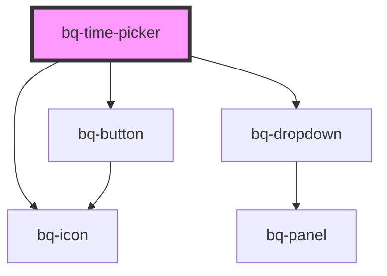

# bq-time-picker

<!-- Auto Generated Below -->

## Overview

The Time Picker lets users enter a time of day by typing into locale-ordered,
keyboard-editable segments or by picking hours, minutes, seconds and AM/PM
from scrollable columns in a dropdown panel.

## Properties

| Property                | Attribute                 | Description                                                                                                                                                  | Type                                                                                                                                                                 | Default              |
| ----------------------- | ------------------------- | ------------------------------------------------------------------------------------------------------------------------------------------------------------ | -------------------------------------------------------------------------------------------------------------------------------------------------------------------- | -------------------- |
| `autofocus`             | `autofocus`               | If `true`, the Time picker field will be focused on component render.                                                                                        | `boolean`                                                                                                                                                            | `false`              |
| `clearButtonLabel`      | `clear-button-label`      | The clear button aria label.                                                                                                                                 | `string`                                                                                                                                                             | `'Clear value'`      |
| `confirmButtonLabel`    | `confirm-button-label`    | The label of the panel confirm (OK) button.                                                                                                                  | `string`                                                                                                                                                             | `'OK'`               |
| `disableClear`          | `disable-clear`           | If `true`, the clear button won't be displayed.                                                                                                              | `boolean`                                                                                                                                                            | `false`              |
| `disableNow`            | `disable-now`             | If `true`, the panel "Now" button won't be displayed.                                                                                                        | `boolean`                                                                                                                                                            | `false`              |
| `disabled`              | `disabled`                | Indicates whether the Time picker is disabled or not.                                                                                                        | `boolean`                                                                                                                                                            | `false`              |
| `distance`              | `distance`                | Distance (gutter) between the Time picker panel and the field.                                                                                               | `number`                                                                                                                                                             | `8`                  |
| `form`                  | `form`                    | The ID of the form the field belongs to.                                                                                                                     | `string`                                                                                                                                                             | `undefined`          |
| `formValidationMessage` | `form-validation-message` | Native form validation message.                                                                                                                              | `string`                                                                                                                                                             | `undefined`          |
| `hourFormat`            | `hour-format`             | Forces a 12-hour (`"12"`) or 24-hour (`"24"`) clock. When unset, the clock of the `locale` is used.                                                          | `"12" \| "24"`                                                                                                                                                       | `undefined`          |
| `hourStep`              | `hour-step`               | Step between selectable hours.                                                                                                                               | `number`                                                                                                                                                             | `1`                  |
| `locale`                | `locale`                  | Locale used for the field layout, the day period labels and the default clock.                                                                               | `Locale \| readonly (string \| Locale)[] \| string`                                                                                                                  | `'en-GB'`            |
| `max`                   | `max`                     | Latest selectable time, in 24-hour format (`HH:mm` or `HH:mm:ss`). Ignored, together with `min`, when it is earlier than `min`.                              | `string`                                                                                                                                                             | `undefined`          |
| `min`                   | `min`                     | Earliest selectable time, in 24-hour format (`HH:mm` or `HH:mm:ss`). Ignored, together with `max`, when it is later than `max`.                              | `string`                                                                                                                                                             | `undefined`          |
| `minuteStep`            | `minute-step`             | Step between selectable minutes.                                                                                                                             | `number`                                                                                                                                                             | `1`                  |
| `name` _(required)_     | `name`                    | The Time picker name.                                                                                                                                        | `string`                                                                                                                                                             | `undefined`          |
| `nowButtonLabel`        | `now-button-label`        | The label of the panel "Now" button.                                                                                                                         | `string`                                                                                                                                                             | `'Now'`              |
| `open`                  | `open`                    | If `true`, the panel is visible.                                                                                                                             | `boolean`                                                                                                                                                            | `false`              |
| `panelHeight`           | `panel-height`            | Overrides the height of the Time picker panel.                                                                                                               | `string`                                                                                                                                                             | `'auto'`             |
| `placement`             | `placement`               | Position of the Time picker panel.                                                                                                                           | `"bottom" \| "bottom-end" \| "bottom-start" \| "left" \| "left-end" \| "left-start" \| "right" \| "right-end" \| "right-start" \| "top" \| "top-end" \| "top-start"` | `'bottom-end'`       |
| `precision`             | `precision`               | The smallest unit edited and submitted. - `hour`   → `HH:00` - `minute` → `HH:mm` (default) - `second` → `HH:mm:ss`                                          | `"hour" \| "minute" \| "second"`                                                                                                                                     | `'minute'`           |
| `readonly`              | `readonly`                | If `true`, the value can be read and submitted but not changed.                                                                                              | `boolean`                                                                                                                                                            | `false`              |
| `requireConfirm`        | `require-confirm`         | If `true`, picks made in the panel (including "Now") are a draft until confirmed with the OK button or Enter. Escape or an outside click discards the draft. | `boolean`                                                                                                                                                            | `false`              |
| `required`              | `required`                | Whether a value must be entered before submitting the form.                                                                                                  | `boolean`                                                                                                                                                            | `false`              |
| `secondStep`            | `second-step`             | Step between selectable seconds.                                                                                                                             | `number`                                                                                                                                                             | `1`                  |
| `skidding`              | `skidding`                | Skidding between the panel and the field.                                                                                                                    | `number`                                                                                                                                                             | `0`                  |
| `strategy`              | `strategy`                | Positioning strategy for the panel.                                                                                                                          | `"absolute" \| "fixed"`                                                                                                                                              | `'fixed'`            |
| `timeButtonLabel`       | `time-button-label`       | The aria-label of the clock trigger button.                                                                                                                  | `string`                                                                                                                                                             | `'Open time picker'` |
| `validationStatus`      | `validation-status`       | Validation state applied to the field.                                                                                                                       | `"error" \| "none" \| "success" \| "warning"`                                                                                                                        | `'none'`             |
| `value`                 | `value`                   | The selected time, in 24-hour format: `HH:mm` (`HH:00` at hour precision) or `HH:mm:ss` at second precision.                                                 | `string`                                                                                                                                                             | `undefined`          |

## Events

| Event      | Description                                                      | Type                                               |
| ---------- | ---------------------------------------------------------------- | -------------------------------------------------- |
| `bqBlur`   | Callback handler emitted when the field loses focus.             | `CustomEvent<HTMLBqTimePickerElement>`             |
| `bqChange` | Callback handler emitted when the value is committed or cleared. | `CustomEvent<{ value: string; el: HTMLElement; }>` |
| `bqClear`  | Callback handler emitted when the value is cleared.              | `CustomEvent<HTMLBqTimePickerElement>`             |
| `bqFocus`  | Callback handler emitted when the field receives focus.          | `CustomEvent<HTMLBqTimePickerElement>`             |

## Methods

### `clear() => Promise<void>`

Clears the selected value and any pending validation state. Emits `bqClear`.
No-op when the component is disabled or read-only.

#### Returns

Type: `Promise<void>`

A promise that resolves once the value has been cleared.

## Slots

| Slot           | Description                                                               |
| -------------- | ------------------------------------------------------------------------- |
| `"clear-icon"` | Icon used inside the clear button.                                        |
| `"label"`      | The label displayed above the field.                                      |
| `"prefix"`     | Content rendered before the field value.                                  |
| `"suffix"`     | Icon rendered inside the clock trigger button (defaults to a clock icon). |

## Shadow Parts

| Part                | Description                                                      |
| ------------------- | ---------------------------------------------------------------- |
| `"base"`            | The component's base wrapper.                                    |
| `"button"`          | Any button rendered by the component.                            |
| `"clear-btn"`       | The clear button.                                                |
| `"column"`          | A scrollable list of options (hours, minutes, seconds or AM/PM). |
| `"columns"`         | The wrapper of the panel columns.                                |
| `"confirm-btn"`     | The confirm (OK) button.                                         |
| `"container"`       | The panel content wrapper.                                       |
| `"control"`         | The field control wrapper.                                       |
| `"footer"`          | The panel footer.                                                |
| `"input"`           | The segmented time field group.                                  |
| `"label"`           | The label slot container.                                        |
| `"now-btn"`         | The "Now" button.                                                |
| `"option"`          | An option inside a column.                                       |
| `"option-selected"` | The selected option of a column.                                 |
| `"panel"`           | The dropdown panel container.                                    |
| `"prefix"`          | The prefix slot container.                                       |
| `"segment"`         | An editable hour, minute, second or AM/PM segment.               |
| `"segment-literal"` | A locale-derived separator between time segments.                |
| `"suffix"`          | The suffix slot container.                                       |
| `"time-trigger"`    | The clock icon trigger button.                                   |

## Dependencies

### Depends on

- [bq-button](../button)
- [bq-dropdown](../dropdown)
- [bq-icon](../icon)

### Graph

----------------------------------------------

*Built with [StencilJS](https://stenciljs.com/)*
